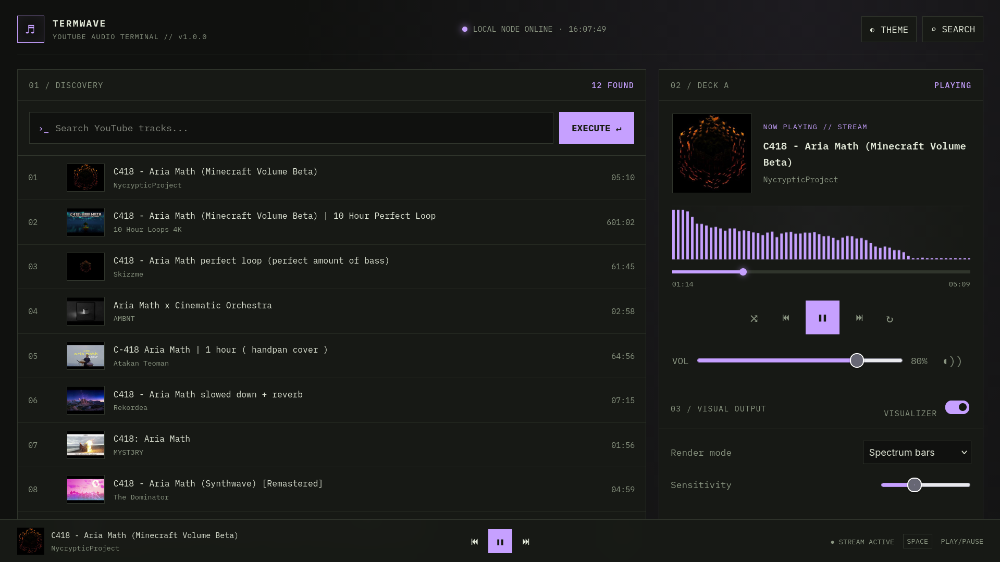
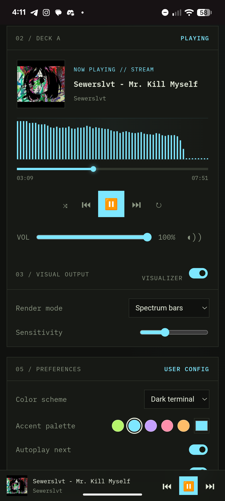

<p align="center">
  
</p>

# TermWave

A terminal-inspired YouTube audio player with YouTube search, a playback queue, cover art, play/pause, seek, volume, shuffle, repeat modes, a Web Audio visualizer, light/dark themes, and customizable accent colors.

## Screenshots

<table>
  <tr>
    <td></td>
     <td></td>
  </tr>
</table>


## Requirements

- Node.js 18 or newer
- Python 3 and `yt-dlp` installed and available on `PATH`
- A modern browser

Install yt-dlp using your preferred package manager, or `python -m pip install -U yt-dlp`. YouTube frequently changes its delivery mechanisms, so keep yt-dlp updated if playback stops working.

## Run locally

```bash
npm install
npm start
```

Open <http://localhost:3000>.

If yt-dlp is installed somewhere not on `PATH`, set `YTDLP_PATH` to its executable path before starting the server. Example on Linux:

```bash
YTDLP_PATH=/home/user/.local/bin/yt-dlp npm start
```

## Deploy to Render

TermWave requires a Node.js server, Python, `yt-dlp`, and FFmpeg. The included `Dockerfile` installs these dependencies and configures the PO Token provider, so deploy it as a **Docker Web Service** rather than a static site.

### 1. Push to GitHub

Push the TermWave repository to GitHub, including the `Dockerfile`, `server.js`, `package.json`, and frontend files. Do not commit your YouTube cookies file or other credentials.

### 2. Create a Render Web Service

1. Sign in to [Render](https://render.com/).
2. Select **New → Web Service**.
3. Connect your GitHub repository.
4. Choose **Docker** as the runtime/environment.
5. Select an instance plan and create the service.

Render should build the image using the repository's `Dockerfile`. The container starts the PO Token provider and then launches TermWave using `npm start`.

**Important:** Do not configure the service as a Static Site. TermWave needs its Express backend to search for videos and resolve audio streams.

### 3. Configure YouTube cookies

YouTube may restrict requests from hosting providers. A valid cookies file may be required for `yt-dlp` to access playable formats.

1. Export your YouTube cookies in Netscape `cookies.txt` format using a trusted method.
2. In your Render service, open **Settings → Secret Files**.
3. Add a secret file with the mount path:

   `/etc/secrets/youtube-cookies.txt`

4. Store the exported cookies in that file.
5. Under **Environment**, add the following variable:

   - **Key:** `YTDLP_COOKIES_FILE`
   - **Value:** `/tmp/youtube-cookies.txt`

The Docker startup command copies the secret file to `/tmp/youtube-cookies.txt`, a writable location, before starting the application. This avoids errors caused by `yt-dlp` trying to update a read-only secret file.

Keep cookies private. They can grant access to your YouTube account, may expire, and should never be committed to GitHub or included in public logs. Consider using a separate account for this purpose.

### 4. Deploy and verify

Trigger a deployment and wait for the build and startup process to complete.

Open your deployed service's `/api/health` endpoint. For example:

`https://your-service.onrender.com/api/health`

Check that the response reports:

- `ok: true`
- `cookiesConfigured: true`
- `cookiesFileExists: true`

Then open TermWave, search for a track, and test playback.

### Troubleshooting

- **Search works, but playback fails:** Check the Render runtime logs for `yt-dlp` errors. YouTube may be rate-limiting the server or requiring updated challenge-solving components.
- **Cookies file missing:** Verify the Render Secret File mount path and confirm the startup command copies it to `/tmp/youtube-cookies.txt`.
- **`yt-dlp` cannot solve YouTube challenges:** The Docker image installs `yt-dlp[default]`, which includes the default dependencies used for JavaScript challenge solving. Keep `yt-dlp` updated.
- **HTTP 429 errors:** YouTube is rate-limiting requests. Valid cookies and PO Tokens do not guarantee that every request will succeed.
- **Service unavailable after inactivity:** Depending on your Render plan, the service may spin down while idle and need time to start again.

Render deployments can be rebuilt whenever the Dockerfile or application code changes. After pushing updates to the connected branch, monitor the deployment logs for build and startup errors.

## Notes

- Search and stream resolution run on the server through yt-dlp; the browser never executes yt-dlp itself.
- Direct YouTube media URLs expire, so the app resolves a fresh URL each time a track starts.
- The visualizer uses the Web Audio API. Some browsers or media CDN responses may restrict audio analysis through cross-origin rules; in that case the UI falls back to an animated idle visualization.
- This is an unofficial personal-use client, not affiliated with YouTube. Respect applicable terms, copyright, and local law.

  
<sub>Project contains AI-assisted code.</sub>
